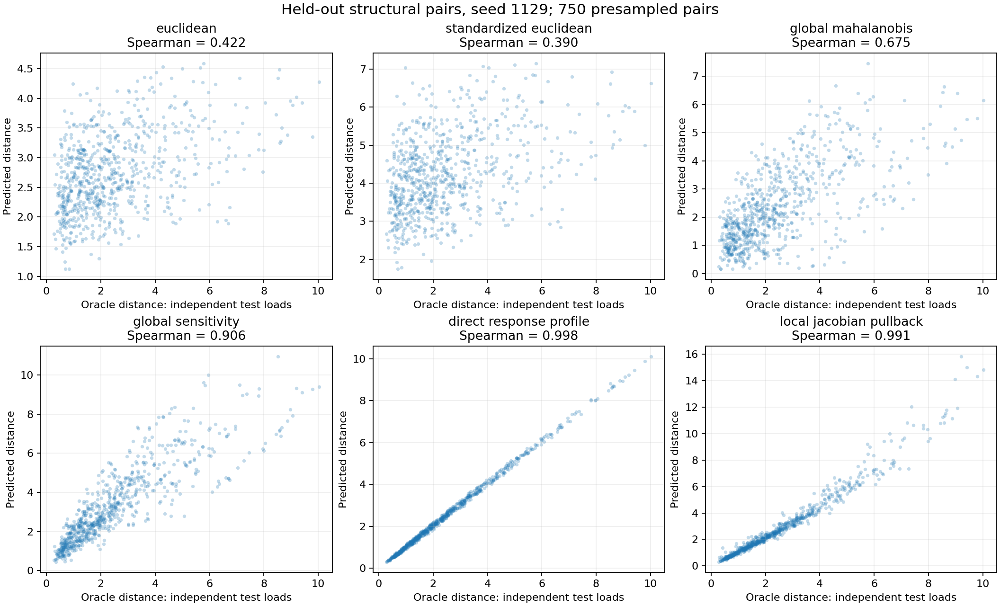
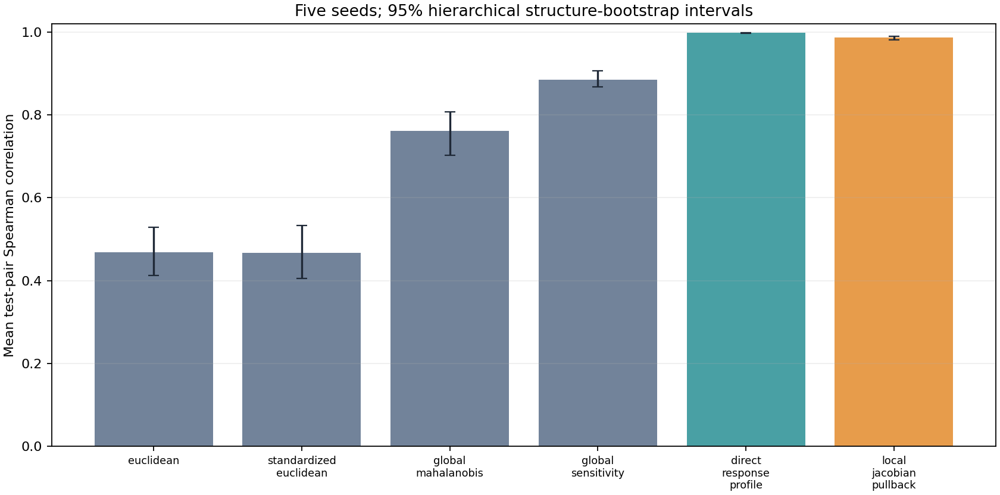

# EXP-001 Scientific Report — Behavioral Geometry on Spring Networks

**Decision: NOT_SUPPORTED.** The prespecified primary comparison of the local Jacobian pullback against the development-selected strongest simple baseline, **direct_response_profile**, gave mean test Spearman difference **-0.011**, with a hierarchical 95% interval **[-0.016, -0.009]**. The meaningful-gain threshold was +0.02. This decision follows the frozen rule in `manifests/PROTOCOL.md`.

## Question and design

We tested whether a response-sensitivity-induced local geometry predicts independent-load structural behavior better than matched simple distances. This is a controlled simulator experiment, not evidence about cells, learned embeddings, topology extrapolation, or real structures. Five independent generator seeds each produced 120 training, 50 development, and 60 test stiffness configurations, with 24/32/128 independently sampled load cases. The topology and load distribution were fixed. Every configuration is a six-DOF constrained scalar spring network with eleven positive springs.

The final oracle was the root-mean-square displacement difference under **test loads only**. Predictions on test configurations used the training load bank; training and development responses supplied fitting and selection. The final runner verified a hash lock on configuration, source, splits, development results, and protocol before it computed any test response. No test response was used for fitting, feature choice, or hyperparameter choice. The selected simple comparator was chosen by mean development Spearman among raw Euclidean, standardized Euclidean, fitted global Mahalanobis, global sensitivity, and direct response profile.

## Mathematical checks and numerical validation

The assembly identity `K=B.T diag(exp(theta)) B` and derivative `du/dtheta_e=-K^-1 (exp(theta_e) b_e b_e.T)u` are exact for this specified linear spring model. `M(theta)=mean_train_load J.T J` is positive semidefinite by construction. The endpoint-averaged quadratic pullback is a local first-order dissimilarity; it is **not** claimed to be a global metric or exact finite response distance. Unit tests compare the analytic derivatives with central differences, test energy assembly, detect singular and indefinite operators, check split integrity, and verify the local first-order approximation. `monograph_checks.py` independently reconstructs five checks described in Appendix B. The separately named companion script was unavailable; these reconstructed checks are not represented as an inspection of its code.

## Held-out results

All Spearman scores use every unordered pair of the 60 test structures per seed. Confidence intervals resample seeds and structures; pairs sharing a structure receive dependent weights instead of being treated as independent observations. Precision@5 is the mean fraction of oracle neighbors recovered among the five nearest structures.

| Method | Mean Spearman | 95% interval | Precision@5 |
|---|---:|---:|---:|
| euclidean | 0.469 | [0.412, 0.529] | 0.294 |
| standardized_euclidean | 0.468 | [0.406, 0.532] | 0.286 |
| global_mahalanobis | 0.761 | [0.703, 0.808] | 0.381 |
| global_sensitivity | 0.886 | [0.868, 0.907] | 0.692 |
| direct_response_profile | 0.998 | [0.997, 0.999] | 0.914 |
| local_jacobian_pullback | 0.987 | [0.982, 0.990] | 0.824 |
| scrambled_response_profile | 0.403 | — | 0.155 |
| scrambled_local_pullback | 0.407 | [0.312, 0.484] | 0.155 |
| permuted_target_mahalanobis | 0.416 | — | 0.263 |

The selected baseline comparison by seed was:

| Seed | Local Spearman | Baseline Spearman | Local minus baseline |
|---:|---:|---:|---:|
| 1129 | 0.991 | 0.998 | -0.007 |
| 2213 | 0.986 | 0.999 | -0.013 |
| 3469 | 0.982 | 0.997 | -0.014 |
| 4561 | 0.988 | 0.999 | -0.011 |
| 5801 | 0.987 | 0.998 | -0.012 |

The primary interval is based on 600 hierarchical bootstrap replicates with fixed bootstrap seed 80117. The local-minus-scrambled-coordinate control mean Spearman gap was 0.579. Coordinate scrambling preserves each structure's stiffness multiset but breaks spring-edge identity; permuting training response-distance labels probes whether global fitting benefits from the correct targets. These are diagnostic controls and do not establish causal superiority by themselves.

## Numerical stability and cost

There were 0 nonfinite predicted distances across methods and seeds. The smallest test stiffness eigenvalue was 0.06897; the largest spectral condition number was 70.46. The smallest computed local tensor eigenvalue was 3.503e-05. `checked_solve` rejects nonsymmetric, singular, near-singular, and indefinite operators. The generator produced no rejected configuration.

Median per-seed test prediction time, including a method's test-structure preprocessing and all pair distances, measured on this machine:

| Method | Median milliseconds per seed |
|---|---:|
| euclidean | 0.1 |
| standardized_euclidean | 0.1 |
| global_mahalanobis | 0.3 |
| global_sensitivity | 0.3 |
| direct_response_profile | 3.8 |
| local_jacobian_pullback | 5.0 |

Training response profiles and Jacobian tensors shared by the trained methods took a median 12.9 ms per seed. Fitting all five Mahalanobis ridge candidates took a median 5.7 ms per seed, excluding development scoring. Timing is descriptive and can vary by machine and BLAS configuration. It is not part of the scientific decision rule.

## Interpretation and limits

The direct response-profile baseline is especially strong in this setting because the exact simulator is available and the training and test load banks come from the same distribution. For this linear model, with `T=K_a^-1-K_b^-1`, squared profile distance is exactly `tr(T C T.T)`, where `C` is the empirical mean of `f f.T` over the chosen load bank. Training and test banks have different empirical `C`, but estimate the same load distribution. The local Jacobian uses an exact derivative but approximates finite differences between distinct structures; the scatter plot shows larger deviations for widely separated structures. Better local approximation for infinitesimal changes is a mathematical statement; better held-out ranking or retrieval is an empirical hypothesis adjudicated above. This benchmark has one fixed network topology, one load family, arbitrary consistent units, only five generator seeds, and no measurement noise or learned response-model error. The reported uncertainty is conditional on this generator and cannot support broad claims about physical structures or intervention embeddings.

## Reproducibility and provenance

- Run the commands in `README.md` from a clean copy. Code, configuration, split manifest, protocol lock, pairwise distances, development selection, and final scores are stored here.
- A fresh temporary-directory rerun passed 11 unit tests and five reconstructed monograph checks, then matched every split-file hash, the selected baseline, the primary estimate and interval, and the decision. See `results/reproduction_check.json`.
- Environment used for the recorded run: Python/NumPy/Matplotlib/Pytest versions are listed in `results/environment.json`; set `OPENBLAS_NUM_THREADS=1` for comparable timing.
- Original monograph: *Geometry That Understands Behavior*, version 1.0, 23 October 2026; PDF SHA-256 `fcea08ff2ad755782cb783a0023726a8b75870099b0d59296c17bddb9971fef4`. The extracted text retained in `references/` has SHA-256 `3280a4bb8682d79022978448564df9489c2a7babae107c560ddf1a8816dad019`. The PDF disappeared from the source directory after extraction, and the named companion script was not found locally or through the connected file search.
